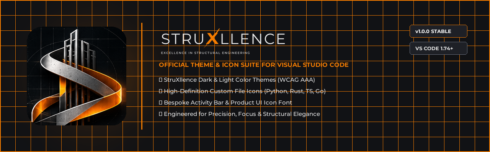
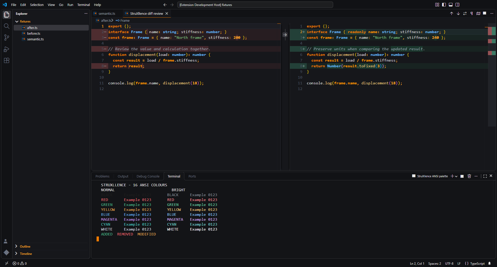
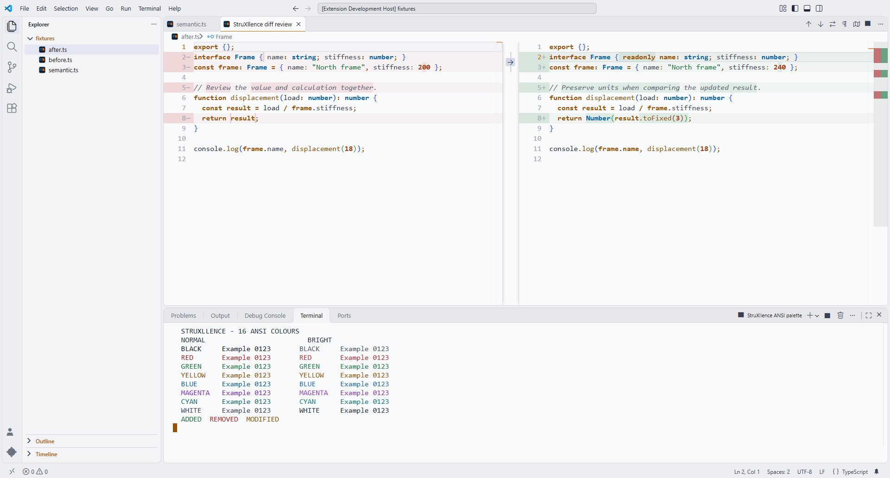
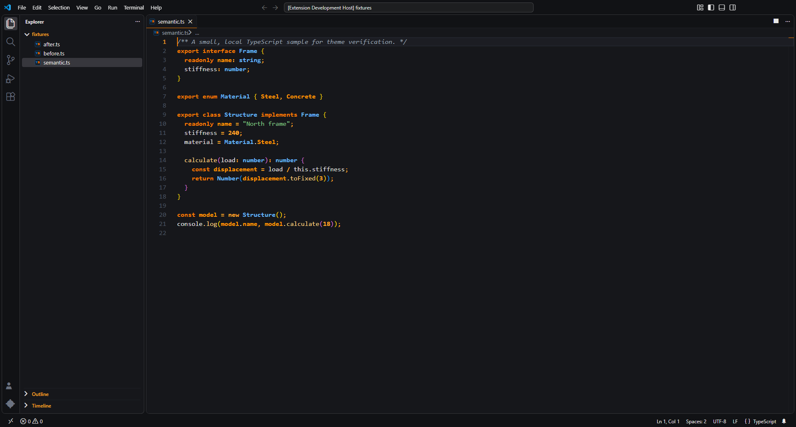
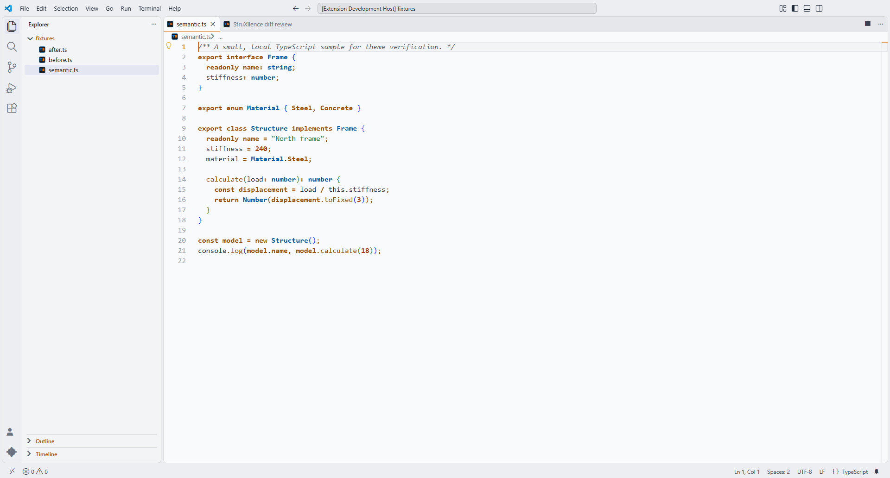
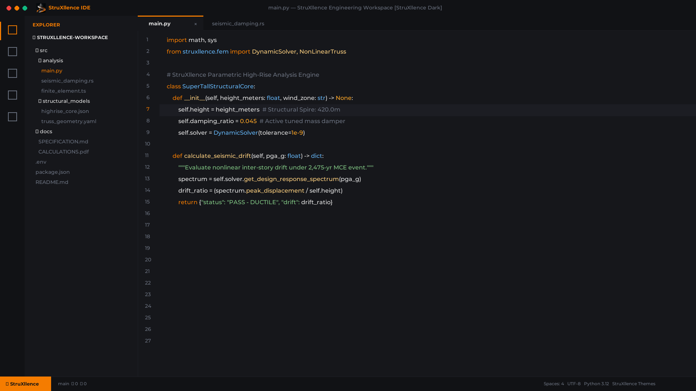
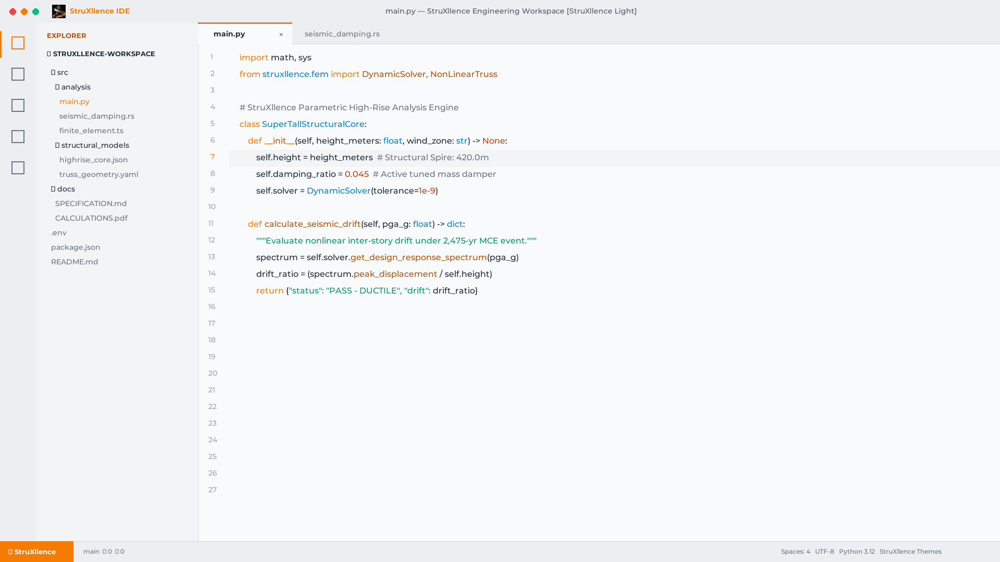
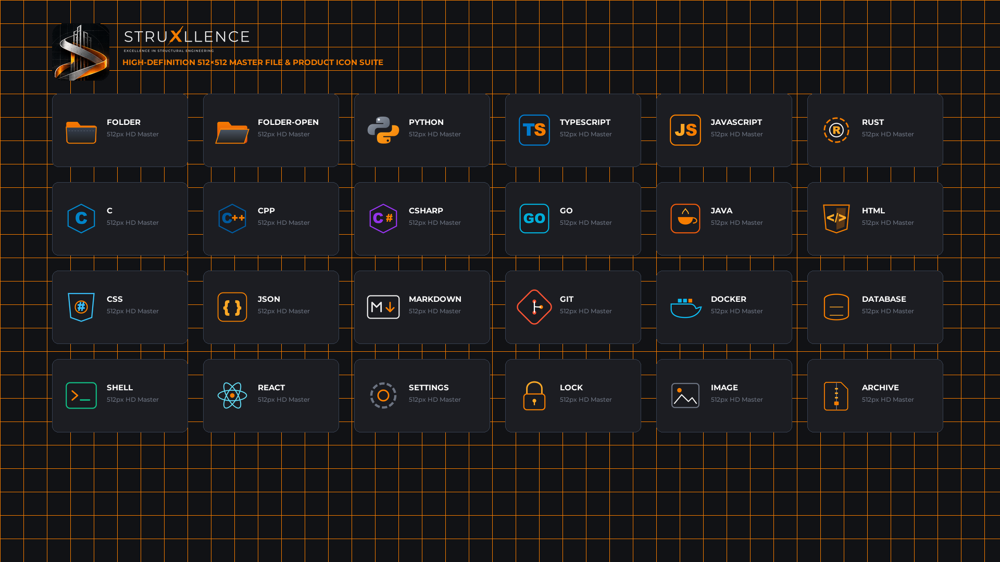

# StruXllence Themes &bull; Visual Studio Code Suite

<div align="center">



[](https://marketplace.visualstudio.com/items?itemName=StruXllence.struxllence-themes)
[](https://marketplace.visualstudio.com/items?itemName=StruXllence.struxllence-themes)

[](https://marketplace.visualstudio.com/items?itemName=StruXllence.struxllence-themes)
[](LICENSE)
[](https://code.visualstudio.com/)

**The definitive luxury engineering theme suite for Visual Studio Code & Visual Studio Code Insiders.**  
*Crafted by Srinivasa Rao Masanam &bull; Published by StruXllence*

[Features](#-key-features) &bull;
[Color Palette](#-color-palette) &bull;
[Previews](#-visual-previews) &bull;
[Installation](#-quick-installation) &bull;
[Activating](#%EF%B8%8F-activating-the-themes) &bull;
[Recommended Font](#-recommended-font-pairing)

</div>

---

## 🌟 Key Features

StruXllence Themes is an all-in-one developer environment package inspired by modern high-rise structural architecture, parametric finite element analysis, and precision fabrication:

- 🎨 **2 Master Color Themes**:
  - **StruXllence Dark**: Deep obsidian and graphite canvas with Innovate Amber highlights (`#F57C00`) and a coordinated code palette.
  - **StruXllence Light**: Clean architectural drafting concrete paper (`#F8F9FA` / `#FFFFFF`) with dark graphite text and warm industrial copper accents.
- 📁 **2 Custom File Icon Themes**:
  - **StruXllence File Icons (Dark & Light)**: Over 30 custom-engineered high-definition icons covering Python, TypeScript, Rust, Go, C++, React, Docker, Git, and documents.
- ⚙️ **2 Product Icon Themes**:
  - **StruXllence Product Icons (Dark & Light)**: Custom UI glyphs for the Activity Bar, Explorer, SCM, Debugger, and Status Bar powered by a bespoke icon font (`struxllence-product-icons.woff`).
- **Integrated terminal**: All **16 normal and bright ANSI colours** are explicitly defined in each theme, alongside terminal background, foreground, cursor, selection and search colours. The light palette uses deeper colours for legibility on its pale background.
- **Semantic highlighting**: Explicit rules cover **23 standard semantic token types**, including types, functions, methods, parameters, properties, enum members and decorators. Read-only variables/properties and deprecated symbols have dedicated styling, coordinated with the TextMate syntax palette.
- **Diffs and source control**: Explicit added/removed line and changed-text backgrounds, diff gutter/overview colours, Git decorations, editor gutters and minimap markers in both themes. Translucent fills preserve the underlying code colours.

### Terminal, semantic and diff behaviour

These areas are configured by the extension, rather than left entirely to the editor's default palette. Both themes define the same set of colour keys and semantic selectors; their actual foregrounds differ to suit the dark and light backgrounds.

Semantic highlighting still requires a language extension that emits semantic tokens. With VS Code's default `editor.semanticHighlighting.enabled: "configuredByTheme"`, both themes opt in. User overrides can disable or replace the styling. Languages without a provider continue to use TextMate syntax highlighting. The extension styles tokens; it does not supply a language server or new semantic token types.

The ANSI palette applies to the normal/bright 16-colour slots. Programs using 256-colour or true-colour escape sequences can choose their own colours, and terminal profiles or user colour customizations can override the result. Dark ANSI black intentionally remains dark because applications also use that slot as a background; VS Code's terminal minimum-contrast adjustment can affect its appearance as text.

Version 1.0.3 checks the defined syntax/semantic foregrounds against the base editor background and composited inserted/removed diff fills at a minimum calculated 4.5:1 ratio. Its terminal palette is checked against the default terminal background, except the intentional dark ANSI-black slot. These checks do **not** certify every interface state, terminal colour pairing, extension or personal accessibility need. Use the preview and your own font/display settings to judge comfort.

### Check the pair in your setup

1. Switch between **StruXllence Dark** and **StruXllence Light** with the same source file and diff open.
2. In a language supported by your installed language extension, run **Developer: Inspect Editor Tokens and Scopes** to see its semantic classification and applied colour.
3. Compare normal/bright ANSI output in the integrated terminal. For a useful bug report, include the theme/extension version, language extension, relevant customization settings, screenshot and a small reproducible sample.

---

## 🎨 Color Palette

| Swatch | Color Name | HEX | Usage |
| :---: | :--- | :--- | :--- |
|  | **Graphite** | `#16171B` / `#F9FAFB` | Dark / light editor backgrounds |
|  | **Steel** | `#9AA3B1` / `#596270` | Dark / light comment text |
|  | **Amber / Copper** | `#F57C00` / `#9B4D00` | Dark / light code keywords; workbench accents retain their own palette |
|  | **Concrete** | `#E7E7E7` | Primary foreground text & high-contrast code |

---

## 📸 Visual Previews

### Terminal, diff and semantic coverage in 1.0.3

Actual VS Code captures with the same TypeScript diff and all 16 ANSI slots. Terminal minimum-contrast adjustment was disabled for these checks so the extension's supplied palette is shown directly. No pointer or capture overlay is included.

**Dark: diff and integrated terminal**



**Light: diff and integrated terminal**



**Semantic highlighting**





The overview artwork below illustrates the broader visual direction; the captures above show the actual 1.0.3 editor, diff and terminal rendering.

### 1. StruXllence Dark Theme


### 2. StruXllence Light Theme


### 3. High-Definition Icon Suite


---

## 🚀 Quick Installation

### Method 1: Direct 1-Click Install
Click the **[Install in VS Code](vscode:extension/StruXllence.struxllence-themes)** badge above or open this link directly in your browser:  
`vscode:extension/StruXllence.struxllence-themes`

### Method 2: In-Editor Quick Open
Press `Ctrl+P` (Windows/Linux) or `Cmd+P` (macOS) and paste:
```bash
ext install StruXllence.struxllence-themes
```

### Method 3: Command Line
```bash
# Standard VS Code
code --install-extension StruXllence.struxllence-themes

# VS Code Insiders
code-insiders --install-extension StruXllence.struxllence-themes
```

---

## 🛠️ Activating the Themes

After installation, activate each component through the Command Palette (`Ctrl+Shift+P` / `Cmd+Shift+P`):

1. **Color Theme**:
   - Run `Preferences: Color Theme` &rarr; Select **StruXllence Dark** or **StruXllence Light**.
2. **File Icon Theme**:
   - Run `Preferences: File Icon Theme` &rarr; Select **StruXllence File Icons (Dark)** or **StruXllence File Icons (Light)**.
3. **Product Icon Theme**:
   - Run `Preferences: Product Icon Theme` &rarr; Select **StruXllence Product Icons (Dark)** or **StruXllence Product Icons (Light)**.

---

## 💡 Recommended Font Pairing

StruXllence Themes was designed to look exceptional with clean modern monospaced programming fonts with ligatures:

- **JetBrains Mono**
- **Fira Code**
- **Cascadia Code**
- **Montserrat** (for UI headlines and sidebars)

```json
{
  "editor.fontFamily": "'JetBrains Mono', 'Fira Code', 'Cascadia Code', Consolas, monospace",
  "editor.fontLigatures": true,
  "editor.fontSize": 14.5,
  "editor.lineHeight": 24
}
```

---

## 💬 Feedback & Community

- **Bugs & Feature Requests:** [Submit an issue](https://github.com/struxllence/struxllence-themes/issues)
- **Official Website:** [https://struxllence.com](https://struxllence.com)
- **Show Your Support:** If you love using StruXllence Themes, please consider leaving a ⭐️⭐️⭐️⭐️⭐️ rating on the [VS Code Marketplace](https://marketplace.visualstudio.com/items?itemName=StruXllence.struxllence-themes)!

---

## 📄 License & Credits

- **Publisher**: **StruXllence** &bull; *Excellence in Structural Engineering*
- **Author**: **Srinivasa Rao Masanam**
- **License**: Released under the [MIT License](LICENSE).
