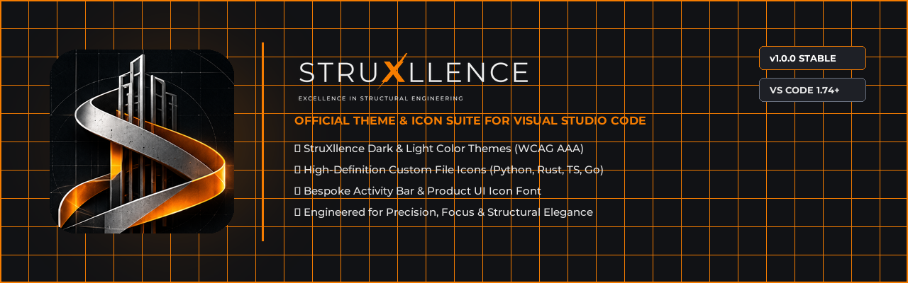
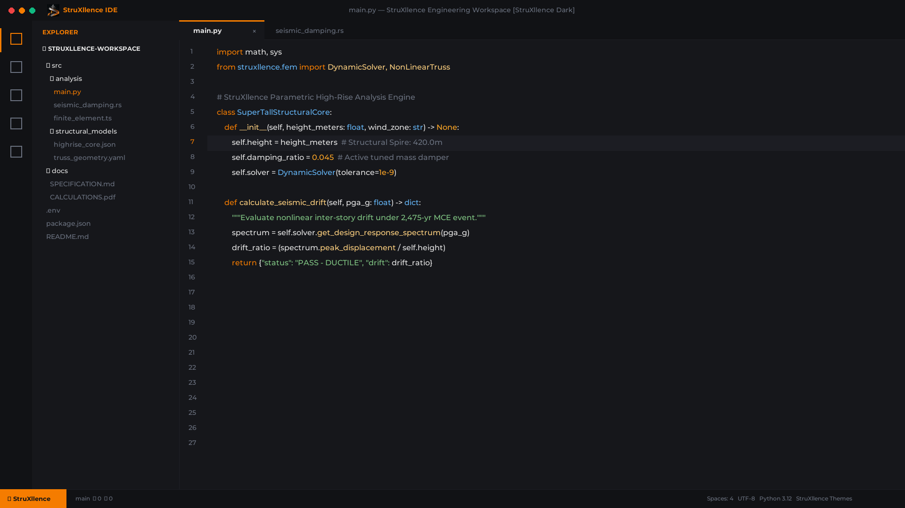
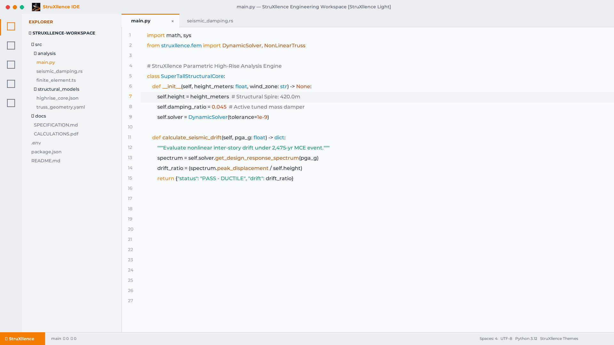
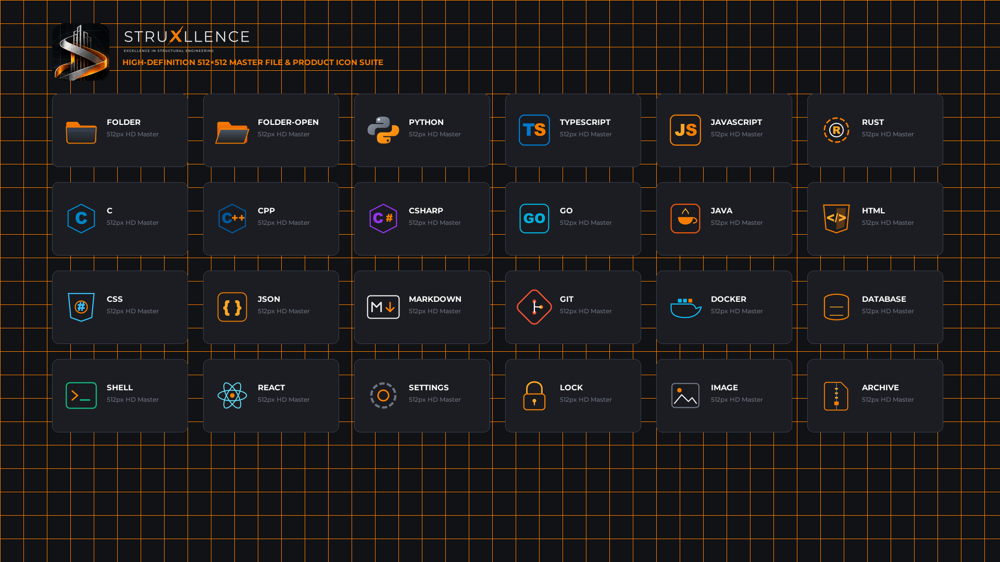

# StruXllence Themes &bull; Visual Studio Code Suite

<div align="center">



[](vscode:extension/StruXllence.struxllence-themes)
[](https://marketplace.visualstudio.com/items?itemName=StruXllence.struxllence-themes)

[](https://marketplace.visualstudio.com/items?itemName=StruXllence.struxllence-themes)
[](LICENSE)
[](https://code.visualstudio.com/)

**The definitive luxury engineering theme suite for Visual Studio Code & Visual Studio Code Insiders.**  
*Crafted by Srinivasa Rao Masanam &bull; Published by StruXllence*

[Features](#-key-features) &bull;
[Color Palette](#-color-palette) &bull;
[Previews](#-visual-previews) &bull;
[Installation](#-quick-installation) &bull;
[Activating](#%EF%B8%8F-activating-the-themes) &bull;
[Recommended Font](#-recommended-font-pairing)

</div>

---

## 🌟 Key Features

StruXllence Themes is an all-in-one developer environment package inspired by modern high-rise structural architecture, parametric finite element analysis, and precision fabrication:

- 🎨 **2 Master Color Themes**:
  - **StruXllence Dark**: Deep obsidian and graphite canvas with radiant molten Innovate Amber highlights (`#F57C00`) and WCAG AAA compliant readability.
  - **StruXllence Light**: Clean architectural drafting concrete paper (`#F8F9FA` / `#FFFFFF`) with dark graphite text and warm industrial copper accents.
- 📁 **2 Custom File Icon Themes**:
  - **StruXllence File Icons (Dark & Light)**: Over 30 custom-engineered high-definition icons covering Python, TypeScript, Rust, Go, C++, React, Docker, Git, and documents.
- ⚙️ **2 Product Icon Themes**:
  - **StruXllence Product Icons (Dark & Light)**: Custom UI glyphs for the Activity Bar, Explorer, SCM, Debugger, and Status Bar powered by a bespoke icon font (`struxllence-product-icons.woff`).
- ⚡ **Zero Eye Fatigue**: Carefully balanced saturation curves and calibrated luminance ratios designed for marathon coding sessions.

---

## 🎨 Color Palette

| Swatch | Color Name | HEX | Usage |
| :---: | :--- | :--- | :--- |
|  | **Graphite** | `#1E1E1E` | Editor background & dark structural panels |
|  | **Steel** | `#6B7280` | Muted comments, borders, inactive tabs |
|  | **Innovate Orange** | `#F57C00` | Keywords, active indicators, cursor, badges |
|  | **Concrete** | `#E7E7E7` | Primary foreground text & high-contrast code |

---

## 📸 Visual Previews

### 1. StruXllence Dark Theme


### 2. StruXllence Light Theme


### 3. High-Definition Icon Suite


---

## 🚀 Quick Installation

### Method 1: Direct 1-Click Install
Click the **[Install in VS Code](vscode:extension/StruXllence.struxllence-themes)** badge above or open this link directly in your browser:  
`vscode:extension/StruXllence.struxllence-themes`

### Method 2: In-Editor Quick Open
Press `Ctrl+P` (Windows/Linux) or `Cmd+P` (macOS) and paste:
```bash
ext install StruXllence.struxllence-themes
```

### Method 3: Command Line
```bash
# Standard VS Code
code --install-extension StruXllence.struxllence-themes

# VS Code Insiders
code-insiders --install-extension StruXllence.struxllence-themes
```

---

## 🛠️ Activating the Themes

After installation, activate each component through the Command Palette (`Ctrl+Shift+P` / `Cmd+Shift+P`):

1. **Color Theme**:
   - Run `Preferences: Color Theme` &rarr; Select **StruXllence Dark** or **StruXllence Light**.
2. **File Icon Theme**:
   - Run `Preferences: File Icon Theme` &rarr; Select **StruXllence File Icons (Dark)** or **StruXllence File Icons (Light)**.
3. **Product Icon Theme**:
   - Run `Preferences: Product Icon Theme` &rarr; Select **StruXllence Product Icons (Dark)** or **StruXllence Product Icons (Light)**.

---

## 💡 Recommended Font Pairing

StruXllence Themes was designed to look exceptional with clean modern monospaced programming fonts with ligatures:

- **JetBrains Mono**
- **Fira Code**
- **Cascadia Code**
- **Montserrat** (for UI headlines and sidebars)

```json
{
  "editor.fontFamily": "'JetBrains Mono', 'Fira Code', 'Cascadia Code', Consolas, monospace",
  "editor.fontLigatures": true,
  "editor.fontSize": 14.5,
  "editor.lineHeight": 24
}
```

---

## 💬 Feedback & Community

- **Bugs & Feature Requests:** [Submit an issue](https://github.com/struxllence/struxllence-themes/issues)
- **Official Website:** [https://struxllence.com](https://struxllence.com)
- **Show Your Support:** If you love using StruXllence Themes, please consider leaving a ⭐️⭐️⭐️⭐️⭐️ rating on the [VS Code Marketplace](https://marketplace.visualstudio.com/items?itemName=StruXllence.struxllence-themes)!

---

## 📄 License & Credits

- **Publisher**: **StruXllence** &bull; *Excellence in Structural Engineering*
- **Author**: **Srinivasa Rao Masanam**
- **License**: Released under the [MIT License](LICENSE).
